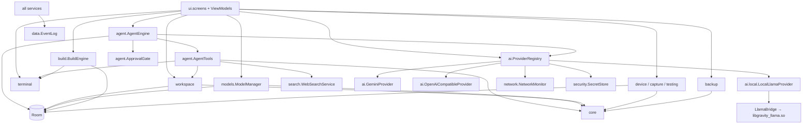

# Gravity architecture

## Layers

| # | Layer | Packages |
|---|---|---|
| 1 | UI | `ui.theme`, `ui.components`, `ui.screens` (Compose) |
| 2 | Presentation | ViewModels in `ui.screens` (`ChatViewModel`, `EditorViewModel`, `FilesViewModel`, `ProjectsViewModel`), created through `gravityViewModel { }` |
| 3 | Domain | `core` (pure Kotlin, no Android imports, unit-tested on the JVM) |
| 4 | Data | `data.db` (Room), `data.settings` (DataStore), `data.EventLog` |
| 5 | AI providers | `ai` (`LlmProvider`, `GeminiProvider`, `OpenAiCompatibleProvider`, `ProviderRegistry`, `ReasoningMapper`), `ai.local` (llama.cpp JNI) |
| 6 | Agent orchestration | `agent` (`AgentEngine`, team workflow, `ApprovalGate`, `TaskForegroundService`) |
| 7 | Tool execution | `agent.AgentTools`, `terminal`, `search` |
| 8 | Workspace | `workspace` (`WorkspaceManager`, `CheckpointManager`, `ProjectTemplate`) |
| 9 | Build | `build.BuildEngine` |
| 10 | Device testing | `device` (inspector, installer, logcat, performance), `capture`, `testing` |
| 11 | Security | `security.SecretStore`, `core.SecretScanner`, `core.CommandSafety`, `core.PathGuard`, `core.BackupCrypto` |
| 12 | Storage | `backup.BackupManager`, `models.ModelManager` |

Dependency injection is manual: `di.AppContainer` builds every service once per process, in dependency order. No annotation processing beyond Room.

## Module dependency map

## Data model (Room, schema v1)

`projects`, `chats`, `messages`, `providers`, `local_models`, `agent_tasks` (including the serialised conversation, used to resume), `events` (the activity log and notifications), `file_versions` (checkpoints with role and model attribution), `builds`, `screenshots`, `teams`, `trash`, `test_results` (test name, expected, actual, outcome and evidence).

Destructive migration is **not** enabled. Any schema change must ship a `Migration`, and the schema is exported to `app/schemas/`.

Other storage: settings in DataStore (`gravity_settings`); secrets as AES-GCM ciphertext in `gravity_secrets` SharedPreferences, under a non-exportable Android Keystore key; files under `filesDir/{workspaces,models,checkpoints,screenshots,trash,builds,home}`.

## Concurrency

- `AppContainer.appScope` (a SupervisorJob on Dispatchers.Default) owns long-lived work: agent tasks, terminal pumps and event writes.
- Blocking I/O runs on `Dispatchers.IO`. HTTP cancellation is immediate: `Http.execute` runs a watcher coroutine that calls `Call.cancel()` when the caller is cancelled.
- Writers to the same file are serialised with per-path mutexes (`WorkspaceManager.withFileLock`). This covers parallel agents and editor saves.
- llama.cpp generation is serialised (`LocalModelHost.generationMutex`). At most one local model is loaded.
- `TaskForegroundService` keeps the process alive while tasks run. Model downloads run as WorkManager foreground work.

## Key flows

**Agent task** (`AgentEngine.run`)
1. Resolve a provider through the operating-mode rules. If that fails offline, the task waits for the network and resumes automatically. Local-only projects refuse cloud providers.
2. Build the system prompt: role, project facts, `GRAVITY.md` project memory, file tree, rules, and an untrusted-content warning.
3. Optional planning pass (Think Plus / Maximum, or the Architect role in a team).
4. Tool loop. Each step calls the model, persists the conversation, then executes the tool calls (dangerous ones wait in `ApprovalGate`). Every write snapshots the file first. The loop ends on `finish`, a plain answer, a pause, or the step limit.
5. In a team, tests run next, then Reviewer and Security reviewer run concurrently on the task's unified diff. Their feedback starts another developer round, up to the configured limit.

**Routing** (`ProviderRegistry.resolve`): Local-only uses the loaded local model. Cloud-only uses a cloud provider and needs a network. Hybrid/Auto use the requested cloud provider; offline they fall back to the local model or wait. A provider that reaches its usage limit hands over to a backup provider. Repeated call failures switch to `backupFor()`.

**Build** (`BuildEngine.build`): a static web build assembles `dist/`, checks local references, then zips. A command build runs in Gravity's shell. A Termux build exports the sources to the shared folder, runs `core.TermuxScript` through `TermuxBridge` (RUN_COMMAND, with the result returned by PendingIntent), then imports and parses the APK. In every backend, **SUCCEEDED requires exit 0 and a real artifact**.

**App test** (`AppTestRunner.run`): launch the app, wait, capture a real frame (if a MediaProjection session is active), read logcat since launch, and detect `FATAL EXCEPTION`. PASS or FAIL is stored with the log and screenshot as evidence.
